<div align="center">


# Nexus

**See what breaks before your stakeholders do.**

A data-lineage and pipeline-operations workspace built on the open-source [Marquez](https://marquezproject.ai) metadata server and the [OpenLineage](https://openlineage.io) standard.

**English** · [Русский](README.ru.md)

[](https://github.com/AyanbergenSaduakassov07/nexus/actions/workflows/ci.yml)


[](LICENSE)

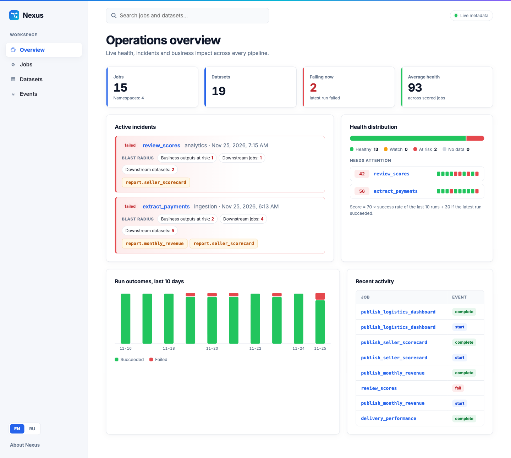

</div>

---

## Contents

- [Why Nexus](#why-nexus)
- [What sets it apart](#what-sets-it-apart)
- [Screenshots](#screenshots)
- [Architecture](#architecture)
- [Demo data: the real Olist dataset](#demo-data-the-real-olist-dataset)
- [Real dbt pipeline, data quality and alerts](#real-dbt-pipeline-data-quality-and-alerts)
- [How the health score works](#how-the-health-score-works)
- [Quick start](#quick-start)
- [Project structure](#project-structure)
- [Testing](#testing)
- [Security](#security)
- [Roadmap](#roadmap)
- [Credits and licenses](#credits-and-licenses)

## Why Nexus

When a nightly job fails, a data team needs answers to three questions within minutes:

1. **What failed?**
2. **What depends on it?** This means every downstream dataset, job and dashboard.
3. **Who will notice?** This means which business reports are now stale or wrong.

Marquez already collects the lineage metadata that holds these answers. Its stock UI is built for metadata engineers, though, and not for the on-call analyst. Nexus is a focused, read-only workspace on the same API. It answers all three questions on a single screen, in English or Russian. Alerts push the same answers to Slack, Telegram or email, and an evidence-grounded copilot drafts the incident note, citing every fact it uses.

## What sets it apart

| | Capability | What you get |
|---|---|---|
| 💥 | **Blast radius** | Every failed job shows how many downstream jobs and datasets it reaches, and names the business reports at risk. |
| ❤️ | **Explainable health score** | Each job gets a score from 0 to 100, computed from its last 10 runs. The formula is printed in the UI. |
| 🚨 | **Incident feed** | The overview opens with active incidents, ranked by blast radius, instead of a table of raw records. |
| 🕸️ | **Impact-aware lineage graph** | Failed nodes are red, the impact zone is amber, and the selected node is outlined. Fit to width shows the whole pipeline at once. |
| 📤 | **Export to Mermaid or SVG** | One click copies the lineage as Mermaid for a pull request or wiki, or downloads it as a self-contained SVG. |
| 🌐 | **Bilingual UI** | A full English and Russian interface with a one-click switch that is remembered. A test ensures every key is translated. |
| 🔒 | **Read-only by design** | The web proxy allows only `GET`. Nexus cannot change your metadata. |
| 🪶 | **Zero dependencies** | Vanilla ES modules with no bundler and no `node_modules`. The whole UI is about 1,300 lines and loads instantly. |
| 📊 | **Real data** | The demo uses the schema of the public Olist e-commerce dataset (100k orders), not toy `foo`/`bar` tables. |
| ✅ | **dbt test results** | A real dbt project emits its tests through OpenLineage. Every dataset shows passed, warning and failed checks with failing row counts. |
| 🧬 | **Column lineage and owners** | Each report shows where every column comes from and how it is computed, from the OpenLineage `columnLineage` facet, plus the owning team from the `ownership` facet. Alerts name the owners of the reports at risk. |
| ⏱ | **SLA freshness and an evidence-grounded copilot** | Reports declare a max age in a custom `sla` facet; breaches show in the UI and in alerts. `alerts/investigate.py` turns a failure into an incident note that cites numbered lineage facts, using a free OpenRouter model. |
| 🔔 | **Alerts anywhere** | Failing jobs, their blast radius and failed checks go to Slack, Telegram, email and 100+ services through Apprise. |

## Screenshots

<table>
<tr>
<td width="50%"><b>Lineage with blast radius</b><br>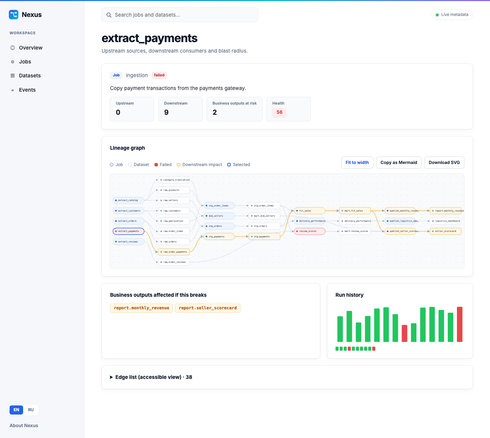</td>
<td width="50%"><b>Job inventory with health and run history</b><br>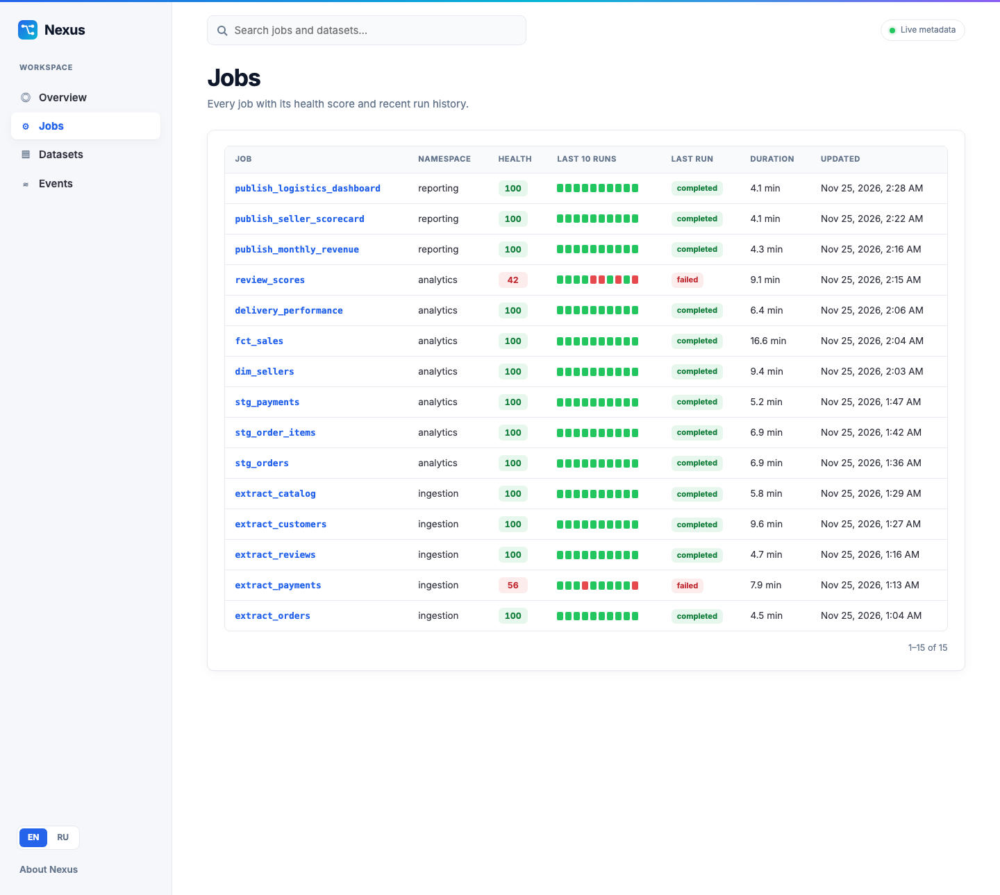</td>
</tr>
<tr>
<td><b>Russian interface</b><br>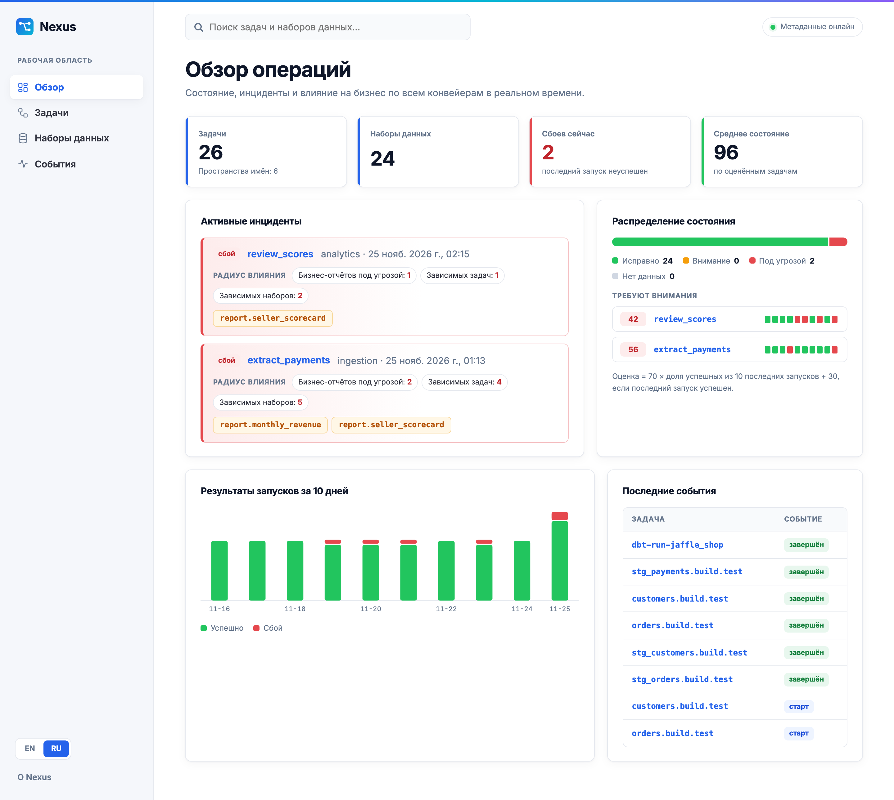</td>
<td><b>Responsive down to phone width</b><br>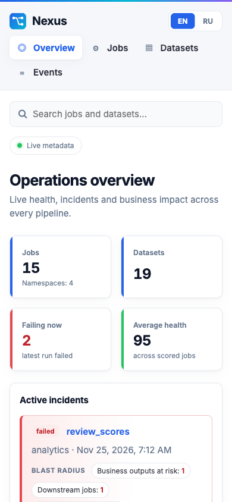</td>
</tr>
<tr>
<td colspan="2"><b>dbt test results from OpenLineage</b><br>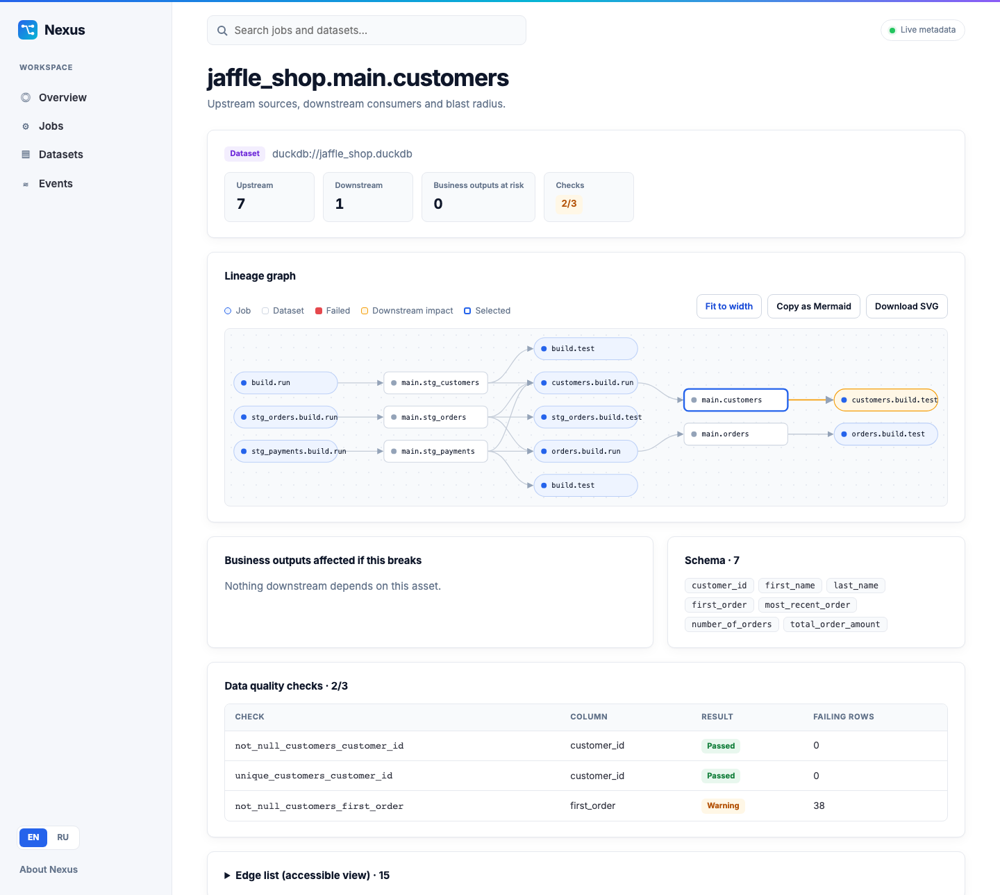</td>
</tr>
<tr>
<td colspan="2"><b>Column lineage of a business report</b><br>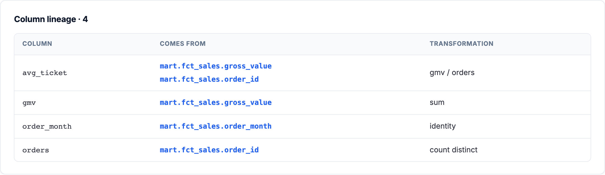</td>
</tr>
</table>

## Architecture

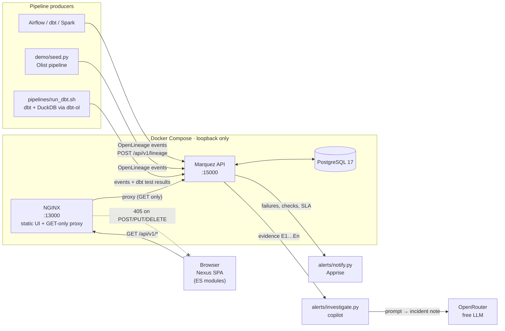

**Design choices**

- **The backend is not forked.** Marquez runs unmodified from a digest-pinned image, so Nexus is a pure UI layer.
- **Analysis runs in the client.** Health, blast radius and daily outcomes are pure functions in `model.js`. They run on data from standard Marquez endpoints and are unit-tested in Node.
- **There is no build step.** The browser loads `nexus.js`, `model.js`, `charts.js` and `i18n.js` directly. NGINX sends `Cache-Control: no-cache`, so a deploy never mixes old and new modules.

### Request flow for the lineage page

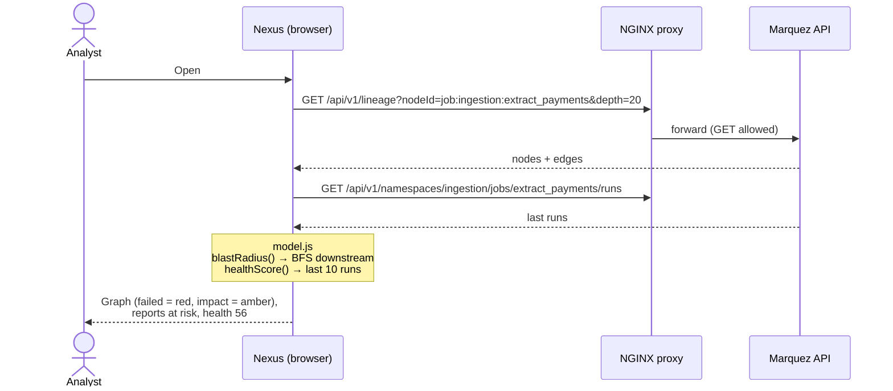

### Frontend modules

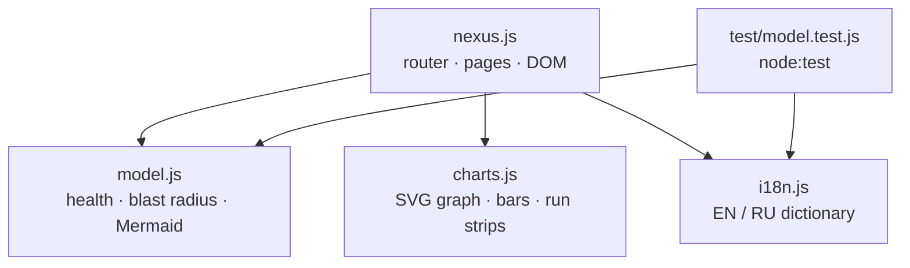

## Demo data: the real Olist dataset

The demo pipeline models the [Brazilian E-Commerce Public Dataset by Olist](https://www.kaggle.com/datasets/olistbr/brazilian-ecommerce). It holds about 100k real orders from 2016–2018, released under CC BY-NC-SA 4.0. Table names, columns and row counts match the published dataset. **Nexus uses only this metadata and redistributes no rows.** Run history is synthetic and deterministic (seed 7), and it includes two realistic failure patterns.

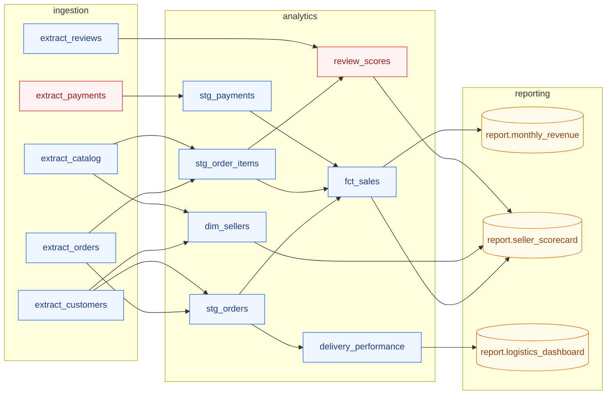

*This is a job-level view (intermediate datasets are omitted). Red jobs are the two failing in the demo. The `extract_payments` failure reaches **9** downstream nodes and puts **2** business reports at risk.*

| Layer | Namespace | Jobs | Example output |
|---|---|---|---|
| Ingestion | `ingestion` | 5 | `raw.orders` with 99,441 rows |
| Transform | `analytics` | 7 | `mart.fct_sales` |
| Reporting | `reporting` | 3 | `report.seller_scorecard` |

## Real dbt pipeline, data quality and alerts

Three open-source projects plug into Nexus through the OpenLineage standard, with no forks and no glue services:

| Project | License | What it adds |
|---|---|---|
| [dbt-labs/jaffle_shop_duckdb](https://github.com/dbt-labs/jaffle_shop_duckdb) | Apache-2.0 | A real dbt project on DuckDB: 3 seeds, 5 models, 20+ tests. Vendored in `pipelines/jaffle_shop/`. |
| [openlineage-dbt](https://github.com/OpenLineage/OpenLineage/tree/main/integration/dbt) | Apache-2.0 | `dbt-ol build` turns every model and test into real OpenLineage events: runs, lineage, schemas and test results. |
| [Apprise](https://github.com/caronc/apprise) | BSD-2-Clause | One notification API for Slack, Telegram, Teams, Discord, email and 100+ other services. |

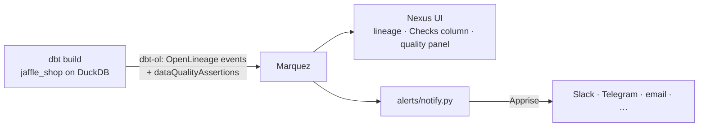

**Data-quality checks in the UI.** dbt test results arrive as the OpenLineage `dataQualityAssertions` facet. The datasets table gets a *Checks* column (passed/total), and each dataset page lists every check with its column, result and failing row count. A `severity: warn` test shows as an amber warning, not a failure. The demo keeps one on purpose: `not_null` on `customers.first_order` finds 38 customers with no orders yet.


**Alerts with blast radius.** `alerts/notify.py` reads the same Marquez API and sends one message per run that lists every failing job, how far its failure reaches downstream, the reports at risk, a deep link into Nexus, and every failed quality check:

```
Nexus: 2 failing jobs, 1 failed check, 2 stale reports

✖ ingestion / extract_payments: FAILED at 2026-11-25T01:13:54Z
  Downstream: 4 jobs, 5 datasets. Outputs at risk: report.monthly_revenue, report.seller_scorecard
  Owners: team:finance, team:marketplace
  http://127.0.0.1:13000/#lineage?kind=job&namespace=ingestion&name=extract_payments

⚠ jaffle_shop.main.customers: not_null_customers_first_order (first_order) failed on 38 rows [warn]

⏱ report.monthly_revenue: last refreshed 41h ago, SLA 24h
⏱ report.seller_scorecard: last refreshed 41h ago, SLA 24h
```

Destinations come from the `NEXUS_ALERT_URLS` environment variable as [Apprise URLs](https://github.com/caronc/apprise/wiki), so no secret lives in the repo. With `--state`, only new failures are sent, so it is safe to run from cron every few minutes.

**SLA freshness.** Business reports carry a small custom OpenLineage facet, `sla` (`{"maxAgeHours": 24}`, schema in [docs/facets/SlaDatasetFacet.json](docs/facets/SlaDatasetFacet.json)). Freshness is the age of the newest dataset version written by a *completed* run, so a run that failed does not count as a refresh. The dataset page shows a green or red *SLA 24h* chip, and the alerter adds a ⏱ line for every report past its limit. In the demo, today's payments failure leaves `report.monthly_revenue` and `report.seller_scorecard` 41 hours old.

**Investigation copilot.** `alerts/investigate.py <namespace> <job>` collects the evidence for one failed job: run history, upstream jobs, failed checks on its inputs, blast radius, SLA breaches and owners. It numbers each fact (E1, E2, …) and asks an LLM for a short incident note in which every sentence cites those ids. The default is a free model through [OpenRouter](https://openrouter.ai) (`openrouter/free`); set `NEXUS_COPILOT_MODEL` to choose another. Without `OPENROUTER_API_KEY` it prints only the evidence. The browser UI never sees the key.

```
$ OPENROUTER_API_KEY=... python3 alerts/investigate.py ingestion extract_payments
[E1] Job extract_payments latest run FAILED at 2026-11-25T01:13:54Z; last 10 runs: 8 COMPLETED, 2 FAILED; ...
[E3] Downstream: 4 jobs, 5 datasets; business outputs: report.monthly_revenue, report.seller_scorecard.
[E4] Output is past its SLA: report.monthly_revenue: last refreshed 41h ago, SLA 24h.
...
Root cause: The latest extract_payments run FAILED [E1]. The evidence has no error message, so it
cannot settle the root cause; check the failed run's log [E1, E2].
Impact: 4 downstream jobs and 5 datasets; two reports are past their 24h SLA [E3, E4, E5].
Who to tell: team:finance and team:marketplace [E6].
```

## How the health score works

```
health = 70 × (successful runs ÷ last 10 runs)  +  30 × (latest run succeeded ? 1 : 0)
```

| Band | Score | Meaning |
|---|---|---|
| 🟢 Healthy | 85–100 | Reliable, and the latest run passed |
| 🟠 Watch | 60–84 | Flaky history or a fresh failure |
| 🔴 At risk | below 60 | Repeated failures, or failing right now |

Two terms make the score explainable. A single failure today costs 30 points straight away, so it shows up. A chronically flaky job stays low even after one green run. Both terms are printed under the health chart, so no one has to guess where a number came from.

**Blast radius** is a breadth-first search over lineage edges, downstream of the failed node. Every dataset in the `report.*` layer that it reaches is listed as a *business output at risk*.

## Quick start

**Requirements:** Docker with Compose v2, Python 3.11+ and OpenSSL. On Apple Silicon, use OrbStack or Docker Desktop with AMD64 emulation.

```sh
git clone https://github.com/AyanbergenSaduakassov07/nexus.git nexus && cd nexus/audit/runtime

# 1. Create a local database password once
[ -e .env ] || (umask 077; printf 'NEXUS_MARQUEZ_DB_PASSWORD=%s\n' "$(openssl rand -hex 32)" > .env)

# 2. Start Marquez, PostgreSQL and the Nexus UI
docker compose up --detach --wait --wait-timeout 180

# 3. Load the Olist demo pipeline (14 days of runs; safe to re-run).
#    Seeded before column lineage existed? Reset first: (cd audit/runtime && docker compose down -v && docker compose up -d --wait)
cd ../.. && python3 demo/seed.py

# 3b. Optional: run the real dbt pipeline and preview an alert
pip install -r pipelines/requirements.txt
pipelines/run_dbt.sh
python3 alerts/notify.py --dry-run
python3 alerts/investigate.py ingestion extract_payments   # evidence; add OPENROUTER_API_KEY for the note

# 4. Open the workspace
open http://127.0.0.1:13000
```

| Surface | Address |
|---|---|
| Nexus workspace | http://127.0.0.1:13000 |
| Marquez REST API | http://127.0.0.1:15000/api/v1/namespaces |
| Admin health | http://127.0.0.1:15001/healthcheck |

To connect a real pipeline, point any OpenLineage integration (Airflow, dbt, Spark or Flink) at `http://127.0.0.1:15000`. Nexus picks up the events on the next page load. See the [runtime guide](audit/runtime/README.md) for stop and resume steps and for diagnostics.

## Project structure

```
nexus/
├── apps/web/
│   ├── public/
│   │   ├── index.html      # app shell
│   │   ├── nexus.js        # router, pages, DOM helpers
│   │   ├── model.js        # pure analysis: health, blast radius, Mermaid export
│   │   ├── charts.js       # SVG lineage graph, bar charts, run strips
│   │   ├── i18n.js         # English and Russian dictionaries
│   │   └── nexus.css       # white, Streamlit-style design system
│   ├── test/model.test.js  # node:test unit tests
│   ├── e2e/browser.mjs     # Playwright check + README screenshots
│   └── default.conf        # NGINX: CSP, GET-only proxy, no-cache
├── demo/seed.py            # Olist pipeline → OpenLineage events
├── pipelines/              # dbt jaffle_shop on DuckDB (vendored, Apache-2.0) + run_dbt.sh
├── alerts/notify.py        # failures + blast radius + failed checks + SLA → Apprise
├── alerts/investigate.py   # evidence-grounded incident note (OpenRouter LLM)
├── audit/runtime/          # Docker Compose stack, CI override, smoke test
├── docs/                   # design roadmap, upstream audit, screenshots
└── upstream/marquez/       # Marquez 0.51.1 source (Apache-2.0)
```

## Testing

```sh
cd apps/web && npm test          # 16 unit tests: health, blast radius, quality, column lineage, owners, freshness, Mermaid, i18n
python3 audit/runtime/smoke.py   # live stack: DB health, UI shell, write rejection, lineage edges
python3 demo/seed.py             # second run must report "Posted 0 events"
python3 -m unittest discover alerts   # 12 tests: alerter (blast radius, owners, SLA, dedupe) + copilot (evidence, model call)
python3 -m unittest discover demo     # 4 seed tests: column lineage, owners, SLA facets, stale reports
cd apps/web && npm run e2e       # browser check in Chromium; rewrites docs/images
```

The unit tests need nothing beyond Node 18+. The smoke test checks against the running stack that the proxy rejects writes and that exact directed lineage edges come back through it. The browser check asserts the demo's numbers, blast radius, Russian labels and phone layout, fails on any console error, and regenerates the README screenshots. It needs Playwright, installed without touching `package.json`: `npm install --no-save playwright@1.64.1 && npx playwright install chromium`.

CI runs all of it on every push: unit tests and lint first, then the full Docker stack with the smoke test, a double seed, the real dbt pipeline, an alerter dry run and the browser check. The screenshots are uploaded as a build artifact.

## Security

- **Strict CSP**: `default-src 'self'`, with no inline scripts, no inline styles and no third-party origins.
- **GET-only proxy**: `limit_except GET { deny all; }` blocks every metadata write from the browser.
- **Loopback binding**: all ports are published on `127.0.0.1` only, and PostgreSQL has no host port.
- **No secrets in the repo**: the database password is generated into a git-ignored `.env` with mode `600`.
- **Safe rendering**: all DOM is built with `textContent` and `createElement`. Nexus never uses `innerHTML` with API data.

## Roadmap

- [x] Lineage graph with impact highlighting
- [x] Blast radius and business outputs at risk
- [x] Explainable health score
- [x] Mermaid and SVG export
- [x] English and Russian UI
- [x] Real-world demo dataset (Olist)
- [x] Real dbt pipeline with data-quality checks
- [x] Slack, Telegram and email alerts (Apprise)
- [x] Column-level lineage view (`columnLineage` facet)
- [x] Ownership facets on business outputs, named in alerts
- [x] SLA / freshness facets on business outputs
- [x] Evidence-grounded investigation copilot (see [design doc](docs/nexus-design.md))

**Next**

- [ ] Run error messages (`errorMessage` facet) as copilot evidence
- [ ] Copilot note on the incident page, served by a backend so the key stays off the browser
- [ ] Freshness history per report

## Credits and licenses

- **Nexus** is released under [Apache-2.0](LICENSE).
- **Marquez** 0.51.1 is © the Marquez project contributors, under [Apache-2.0](upstream/marquez/LICENSE). See the [upstream audit](docs/upstream-audit.md).
- **OpenLineage** is an LF AI & Data project.
- **Olist dataset** is © Olist, under [CC BY-NC-SA 4.0](https://creativecommons.org/licenses/by-nc-sa/4.0/). Only schema metadata is used.
- **jaffle_shop_duckdb** is © dbt Labs, under [Apache-2.0](pipelines/jaffle_shop/LICENSE). See [NOTICE](pipelines/jaffle_shop/NOTICE.md).
- **openlineage-dbt** (Apache-2.0) and **Apprise** (BSD-2-Clause) are installed from PyPI, not vendored.
- **OpenRouter** is an external API, called only by the optional copilot when `OPENROUTER_API_KEY` is set.

<div align="center"><sub>Built by Ayanbergen Saduakassov</sub></div>
