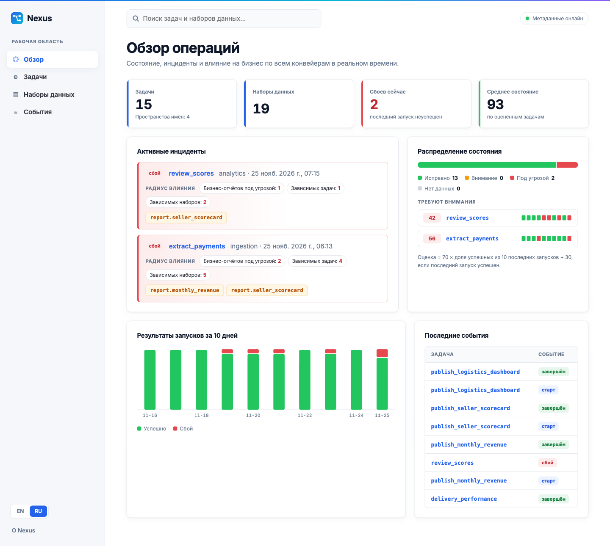
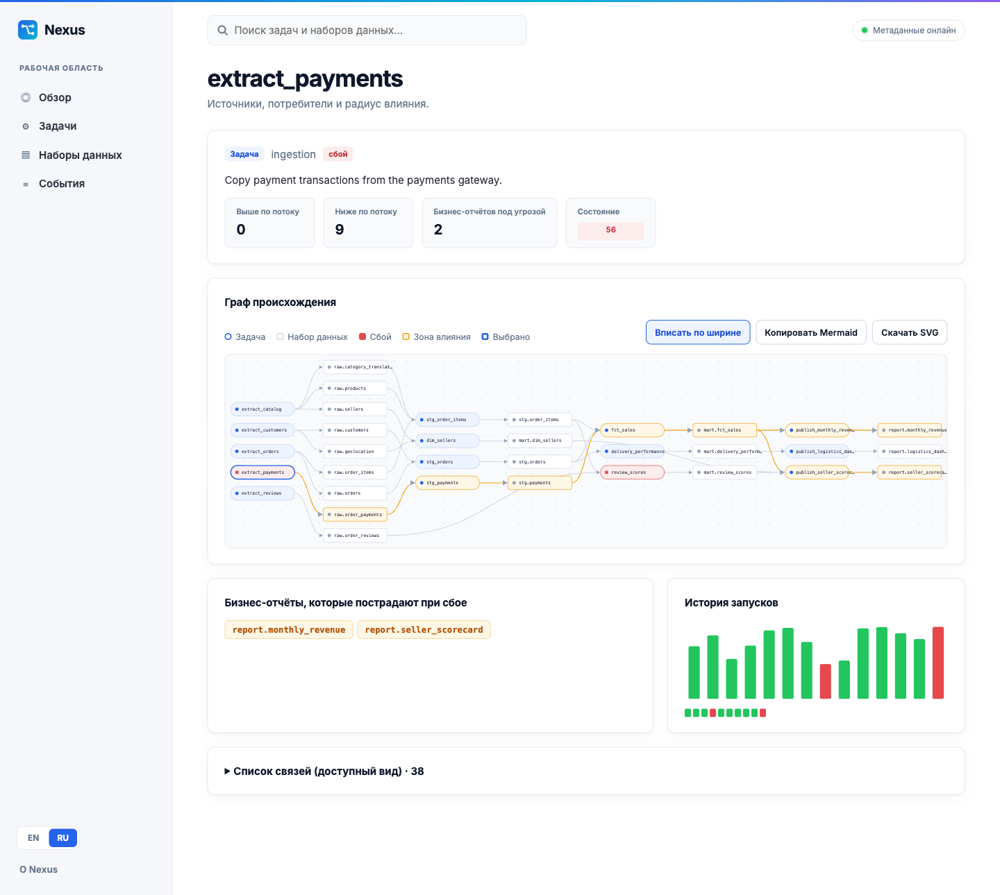
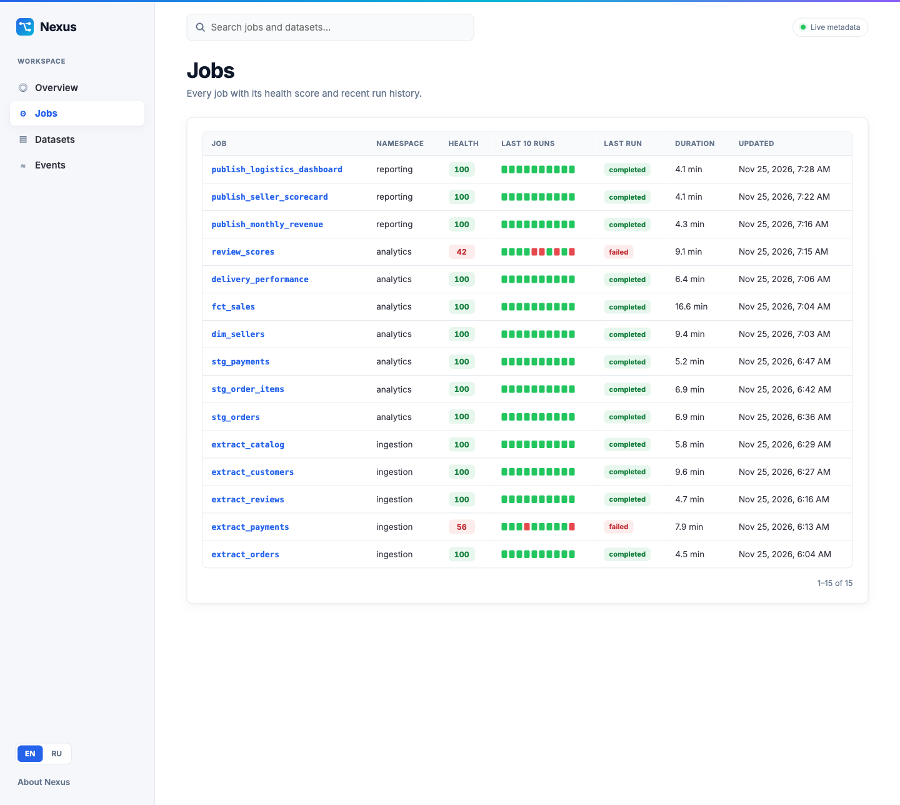
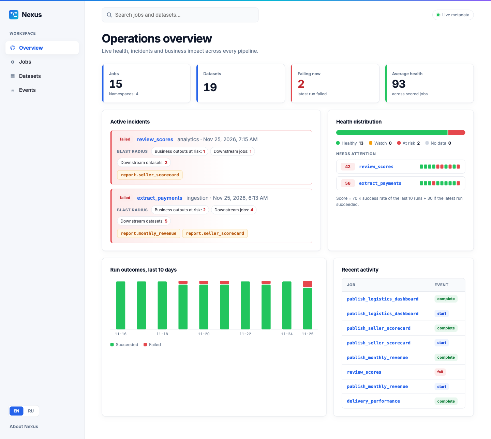
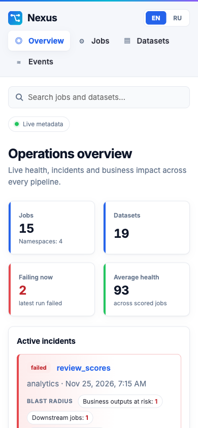
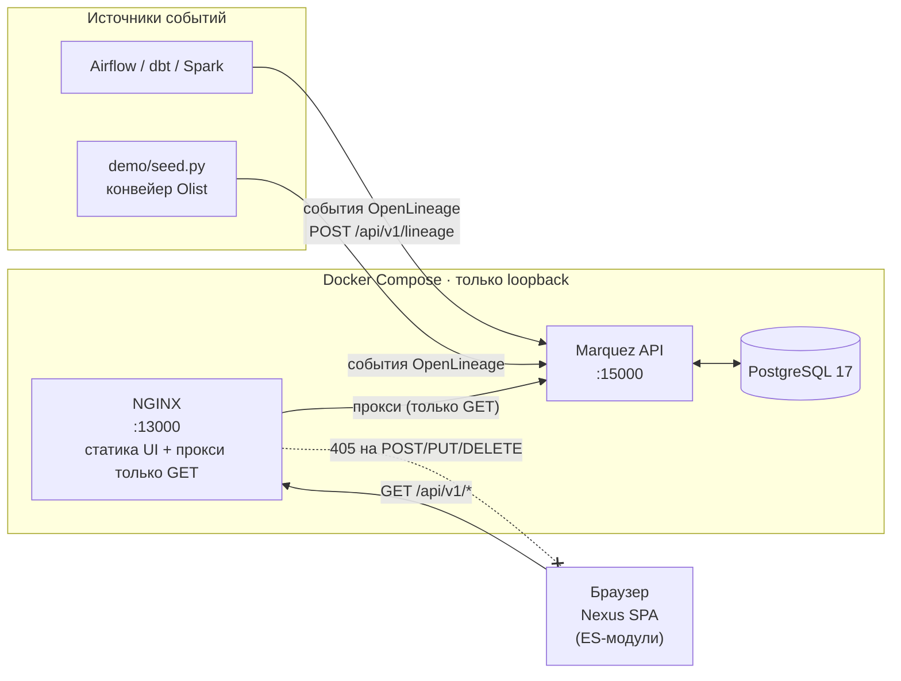
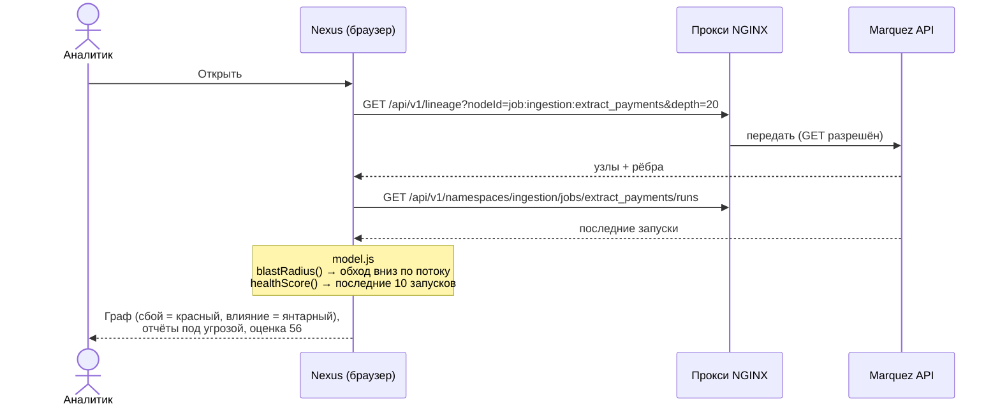
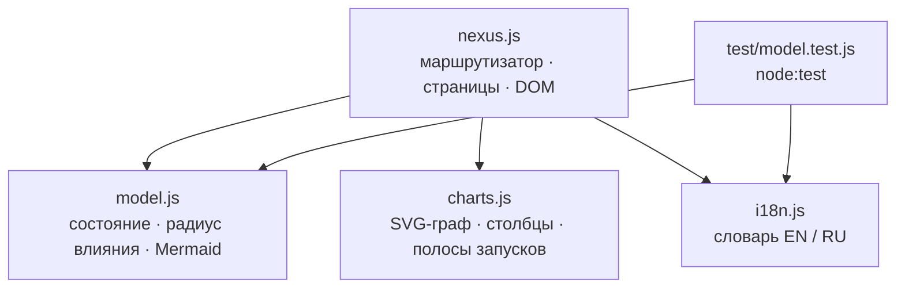
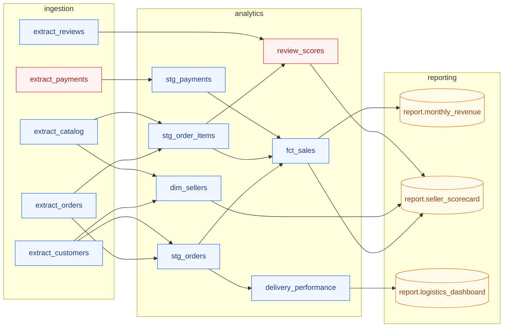

<div align="center">


# Nexus

**Узнайте, что сломалось, раньше, чем заметит бизнес.**

Рабочее пространство для происхождения данных (data lineage) и эксплуатации конвейеров. Построено на открытом сервере метаданных [Marquez](https://marquezproject.ai) и стандарте [OpenLineage](https://openlineage.io).

[English](README.md) · **Русский**

[](https://github.com/AyanbergenSaduakassov07/nexus/actions/workflows/ci.yml)


[](LICENSE)



</div>

---

## Содержание

- [Зачем нужен Nexus](#зачем-нужен-nexus)
- [Чем он отличается](#чем-он-отличается)
- [Скриншоты](#скриншоты)
- [Архитектура](#архитектура)
- [Демо-данные: реальный датасет Olist](#демо-данные-реальный-датасет-olist)
- [Как считается оценка состояния](#как-считается-оценка-состояния)
- [Быстрый старт](#быстрый-старт)
- [Структура проекта](#структура-проекта)
- [Тестирование](#тестирование)
- [Безопасность](#безопасность)
- [Дорожная карта](#дорожная-карта)
- [Авторы и лицензии](#авторы-и-лицензии)

## Зачем нужен Nexus

Когда ночная задача падает, команде данных нужно за несколько минут ответить на три вопроса:

1. **Что упало?**
2. **Что от этого зависит?** То есть все наборы данных, задачи и дашборды ниже по потоку.
3. **Кто это заметит?** То есть какие бизнес-отчёты теперь устарели или неверны.

Marquez уже собирает метаданные происхождения, в которых есть эти ответы. Но его стандартный интерфейс сделан для инженеров метаданных, а не для дежурного аналитика. Nexus — это сфокусированное рабочее пространство на том же API, только для чтения. Он отвечает на все три вопроса на одном экране, на русском или английском.

## Чем он отличается

| | Возможность | Что вы получаете |
|---|---|---|
| 💥 | **Радиус влияния** | Для каждой упавшей задачи видно, сколько задач и наборов ниже по потоку она затрагивает и какие бизнес-отчёты под угрозой. |
| ❤️ | **Объяснимая оценка состояния** | Каждая задача получает оценку от 0 до 100 по последним 10 запускам. Формула показана прямо в интерфейсе. |
| 🚨 | **Лента инцидентов** | Обзор начинается с активных инцидентов, отсортированных по радиусу влияния, а не с таблицы сырых записей. |
| 🕸️ | **Граф происхождения с зоной влияния** | Упавшие узлы красные, зона влияния янтарная, выбранный узел выделен рамкой. Кнопка «Вписать по ширине» показывает весь конвейер целиком. |
| 📤 | **Экспорт в Mermaid или SVG** | Один клик копирует граф в Mermaid для pull request или вики либо скачивает самодостаточный SVG. |
| 🌐 | **Двуязычный интерфейс** | Полный русский и английский интерфейс с переключением в один клик, выбор запоминается. Тест проверяет, что переведён каждый ключ. |
| 🔒 | **Только чтение** | Веб-прокси пропускает только `GET`. Nexus не может изменить ваши метаданные. |
| 🪶 | **Ноль зависимостей** | Чистые ES-модули без сборщика и без `node_modules`. Весь интерфейс занимает около 1100 строк и загружается мгновенно. |
| 📊 | **Реальные данные** | Демо использует схему публичного датасета e-commerce Olist (100 тыс. заказов), а не игрушечные таблицы `foo`/`bar`. |

## Скриншоты

<table>
<tr>
<td width="50%"><b>Граф происхождения с радиусом влияния</b><br></td>
<td width="50%"><b>Задачи: состояние и история запусков</b><br></td>
</tr>
<tr>
<td><b>Английский интерфейс</b><br></td>
<td><b>Адаптивная вёрстка до ширины телефона</b><br></td>
</tr>
</table>

## Архитектура



**Архитектурные решения**

- **Бэкенд не форкнут.** Marquez работает без изменений из образа, закреплённого по дайджесту. Nexus — чистый слой интерфейса.
- **Анализ выполняется на клиенте.** Оценка состояния, радиус влияния и итоги по дням — это чистые функции в `model.js`. Они работают с данными стандартных эндпоинтов Marquez и покрыты юнит-тестами в Node.
- **Нет шага сборки.** Браузер напрямую загружает `nexus.js`, `model.js`, `charts.js` и `i18n.js`. NGINX отдаёт `Cache-Control: no-cache`, поэтому после деплоя старые и новые модули никогда не смешиваются.

### Поток запросов страницы происхождения



### Модули фронтенда



## Демо-данные: реальный датасет Olist

Демо-конвейер моделирует [Brazilian E-Commerce Public Dataset by Olist](https://www.kaggle.com/datasets/olistbr/brazilian-ecommerce). Это около 100 тыс. реальных заказов за 2016–2018 годы, опубликованных под лицензией CC BY-NC-SA 4.0. Имена таблиц, колонки и число строк совпадают с опубликованным датасетом. **Nexus использует только эти метаданные и не распространяет ни одной строки данных.** История запусков синтетическая и детерминированная (seed 7). В ней есть два реалистичных сценария сбоев.



*Это вид на уровне задач: промежуточные наборы данных скрыты. Красным отмечены две задачи, которые падают в демо. Сбой `extract_payments` затрагивает **9** узлов ниже по потоку и ставит под угрозу **2** бизнес-отчёта.*

| Слой | Пространство имён | Задач | Пример выхода |
|---|---|---|---|
| Загрузка | `ingestion` | 5 | `raw.orders` на 99 441 строку |
| Преобразование | `analytics` | 7 | `mart.fct_sales` |
| Отчётность | `reporting` | 3 | `report.seller_scorecard` |

## Как считается оценка состояния

```
оценка = 70 × (успешных ÷ последние 10 запусков)  +  30 × (последний запуск успешен ? 1 : 0)
```

| Диапазон | Оценка | Значение |
|---|---|---|
| 🟢 Исправно | 85–100 | Стабильная задача, последний запуск прошёл |
| 🟠 Внимание | 60–84 | Нестабильная история или свежий сбой |
| 🔴 Под угрозой | ниже 60 | Повторяющиеся сбои или падает прямо сейчас |

Два слагаемых делают оценку объяснимой. Один сбой сегодня сразу снимает 30 баллов, поэтому он заметен. Хронически нестабильная задача остаётся низкой даже после одного зелёного запуска. Оба слагаемых выведены под графиком состояния, поэтому никому не нужно гадать, откуда взялось число.

**Радиус влияния** — это обход в ширину по рёбрам происхождения вниз по потоку от упавшего узла. Каждый достигнутый набор данных из слоя `report.*` показывается как *бизнес-отчёт под угрозой*.

## Быстрый старт

**Требования:** Docker с Compose v2, Python 3.11+ и OpenSSL. На Apple Silicon используйте OrbStack или Docker Desktop с эмуляцией AMD64.

```sh
git clone https://github.com/AyanbergenSaduakassov07/nexus.git nexus && cd nexus/audit/runtime

# 1. Один раз создайте локальный пароль БД
[ -e .env ] || (umask 077; printf 'NEXUS_MARQUEZ_DB_PASSWORD=%s\n' "$(openssl rand -hex 32)" > .env)

# 2. Запустите Marquez, PostgreSQL и интерфейс Nexus
docker compose up --detach --wait --wait-timeout 180

# 3. Загрузите демо-конвейер Olist (14 дней запусков, можно перезапускать)
cd ../.. && python3 demo/seed.py

# 4. Откройте рабочее пространство
open http://127.0.0.1:13000
```

| Сервис | Адрес |
|---|---|
| Рабочее пространство Nexus | http://127.0.0.1:13000 |
| REST API Marquez | http://127.0.0.1:15000/api/v1/namespaces |
| Проверка состояния | http://127.0.0.1:15001/healthcheck |

Чтобы подключить реальный конвейер, направьте любую интеграцию OpenLineage (Airflow, dbt, Spark или Flink) на `http://127.0.0.1:15000`. Nexus подхватит события при следующей загрузке страницы. Остановка, возобновление и диагностика описаны в [руководстве по запуску](audit/runtime/README.md).

## Структура проекта

```
nexus/
├── apps/web/
│   ├── public/
│   │   ├── index.html      # оболочка приложения
│   │   ├── nexus.js        # маршрутизатор, страницы, DOM-хелперы
│   │   ├── model.js        # чистый анализ: состояние, радиус влияния, экспорт Mermaid
│   │   ├── charts.js       # SVG-граф, столбчатые диаграммы, полосы запусков
│   │   ├── i18n.js         # словари EN и RU
│   │   └── nexus.css       # белая дизайн-система в стиле Streamlit
│   ├── test/model.test.js  # юнит-тесты node:test
│   └── default.conf        # NGINX: CSP, прокси только GET, no-cache
├── demo/seed.py            # конвейер Olist → события OpenLineage
├── audit/runtime/          # стек Docker Compose и smoke-тест
├── docs/                   # дорожная карта, аудит апстрима, скриншоты
└── upstream/marquez/       # исходники Marquez 0.51.1 (Apache-2.0)
```

## Тестирование

```sh
cd apps/web && npm test          # 9 юнит-тестов: состояние, радиус влияния, Mermaid, полнота перевода
python3 audit/runtime/smoke.py   # живой стек: здоровье БД, оболочка UI, запрет записи, рёбра графа
```

Юнит-тестам нужен только Node 18+. Smoke-тест проверяет на запущенном стеке, что прокси отклоняет запись и что через него возвращаются точные направленные рёбра графа.

## Безопасность

- **Строгий CSP**: `default-src 'self'`, без встроенных скриптов, без встроенных стилей и без сторонних источников.
- **Прокси только для GET**: `limit_except GET { deny all; }` блокирует любую запись метаданных из браузера.
- **Только loopback**: все порты открыты лишь на `127.0.0.1`, у PostgreSQL нет порта на хосте.
- **Нет секретов в репозитории**: пароль БД генерируется в `.env` с правами `600`, и этот файл исключён из git.
- **Безопасный рендеринг**: весь DOM строится через `textContent` и `createElement`. Nexus никогда не использует `innerHTML` с данными API.

## Дорожная карта

- [x] Граф происхождения с подсветкой влияния
- [x] Радиус влияния и бизнес-отчёты под угрозой
- [x] Объяснимая оценка состояния
- [x] Экспорт в Mermaid и SVG
- [x] Интерфейс на русском и английском
- [x] Реальный демо-датасет (Olist)
- [ ] Происхождение на уровне колонок (`/column-lineage`)
- [ ] Владельцы и SLA для бизнес-отчётов
- [ ] Помощник расследования инцидентов на основе фактов (см. [дизайн-документ](docs/nexus-design.md))
- [ ] Уведомления об инцидентах в Slack и Telegram

## Авторы и лицензии

- **Nexus** распространяется под лицензией [Apache-2.0](LICENSE).
- **Marquez** 0.51.1 © участники проекта Marquez, лицензия [Apache-2.0](upstream/marquez/LICENSE). См. [аудит апстрима](docs/upstream-audit.md).
- **OpenLineage** — проект LF AI & Data.
- **Датасет Olist** © Olist, лицензия [CC BY-NC-SA 4.0](https://creativecommons.org/licenses/by-nc-sa/4.0/). Используются только метаданные схемы.

<div align="center"><sub>Автор: Ayanbergen Saduakassov</sub></div>
