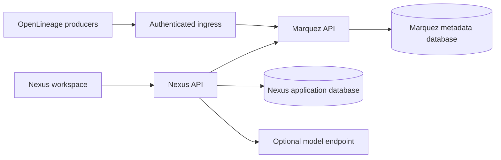

# Nexus product design and implementation roadmap

The initial Nexus release provides a custom workspace for existing Marquez metadata and lineage. Later releases will add business impact, scoring, and cited investigations.

## Architecture decision

| Rank | Approach | Trade-off |
|---|---|---|
| 1 | **Unmodified Marquez backend with a Nexus service and UI.** Use the public REST API and OpenLineage, and keep Nexus-owned data in PostgreSQL. | Preserves ingestion, metadata, history, SQL and migrations. The adapter must handle upstream pagination, limits, schema drift and incomplete evidence. |
| 2 | Patch a small Marquez fork and retain the same architecture. | Suitable for a proven contract gap, runtime compatibility update, or a focused performance fix. Adds downstream maintenance and release obligations for each patch. |
| 3 | Build the new workflows inside Marquez's server and web application. | Shares deployment and data structures. Couples product development to upstream migrations, UI dependencies and release cycles. |

Use approach 1. The initial workspace uses browser JavaScript and a read-only proxy. The later intelligence service can add a modular TypeScript backend on Node 24 LTS and continue using Java 17 Marquez and PostgreSQL. Qualify source changes with a runnable contract or support test. Start with one organization per instance for the intelligence service. [Node.js release lifecycle](https://nodejs.org/en/about/previous-releases)



The browser uses same-origin Nexus APIs. A typed adapter owns encoding of namespace/name references, pagination, input and response validation, deadlines, and normalized errors. The Nexus service uses a separate database and runtime role for business assets, ownership, SLO policies, graph and score snapshots, incident evidence, and audit records. Production separates migration and runtime roles. Marquez owns upstream metadata, with communication through HTTP. Cache only scoped data and key by identity or authorization scope, graph revision and policy version. Requests outside the supported evidence window return partial results or a clear error.

OIDC session roles cover viewer, operator, and administrator. Dataset and job scope derives from the session's approved namespaces. Registry permissions also govern business assets. Each query, snapshot, export and tool invocation rechecks scope server-side. Traverse only edges whose endpoints and evidence the actor may view. A visible asset reached exclusively through a hidden namespace is absent from results, with no disclosure of hidden paths or counts. Authenticated producer identities are scoped to allowed namespaces and ingestion routes. Only internal services can reach Marquez API and admin. Facets can include SQL, URLs and arbitrary content. The API uses allowlisted display fields and redacts sensitive values before indexing, logging, export, or model transfer.

### Proposed repository

```text
nexus/
  upstream/marquez/       Imported Marquez source, history and license
  apps/
    web/                  Nexus workspace and design tokens
    api/                  Routes, adapter, impact, health, investigation
  demo/                   PostgreSQL seed, scheduled jobs, scenarios, expected outputs
  deploy/                 Compose profiles and production deployment configuration
  tests/                  Cross-service contracts, integration, browser and load tests
  docs/                   Decision records, operator guide, public API and license inventory
  audit/runtime/          Local Nexus installation and smoke test
```

Keep the Marquez source under `upstream/marquez/` and use its pinned API image in the local stack. The audit records the source revision and the Compose recipe pins OCI digests. Upgrades run contract tests, rehearse migrations against a representative database, and update provenance. Mark any changes to upstream files with modification notices.

## Product specifications

### Nexus workspace and design system

**Primary workflows.** Overview shows active incidents with severity, affected business outputs, freshness, and evidence coverage. Catalog presents jobs, datasets, and governed business assets. An asset page places the lineage graph beside an inspector showing upstream changes, downstream consumers, owner, SLO, and evidence. The incident page puts the timeline and impact summary first, with the investigation panel anchored to the incident's evidence snapshot.

| Foundation | Proposed design |
|---|---|
| Identity | Nexus wordmark with an original icon, near-white work surface, dark ink and teal action colors. Keep the UI suitable for long sessions and dense tables. |
| Color tokens | Canvas `#F5F7F9`, surface `#FFFFFF`, main text `#14212C`, muted text `#475569`, action/focus `#0F766E`, critical `#B42318`, warning `#8A4B08`. Pair every status with text and an icon. Verify contrast for each actual foreground/background pairing. |
| Type and spacing | Inter for UI and tabular numerals, a system monospace stack for identifiers, 14 px body, 20 px pane headings, 28 px page headings. Use a 4 px spacing unit, 8 px panel corners and clear keyboard focus. Bundle and attribute selected font files in the artifact. |
| Navigation and layout | Persistent labels for Overview, Catalog and Incidents. At desktop widths show the navigation, workspace and evidence inspector together. At narrow widths show the inspector on a dedicated route and offer a structured lineage list. |
| Graph and tables | Dataset and job shapes have distinct labels. Show arrow direction, depth, and the selected path, plus a keyboard-accessible path table that uses the same data. Use explicit sort order, UTC or the selected timezone, and timestamps with visible stale states. |
| Interaction states | Components cover loading, empty, partial, stale, authorization-denied, and failed requests. Error messages include a scoped retry action when available. Each score and impact row opens its evidence. |

Target WCAG 2.2 AA. Test at 390, 768 and 1440 CSS px with keyboard-only navigation. Cover focus order and visibility, contrast, zoom and reflow, and the accessible graph alternative. [WCAG 2.2](https://www.w3.org/TR/WCAG22/)

### Business impact analysis

**Inputs.** The trigger is a dataset, job, run, or column reference plus a reason, time, and actor scope. Stable references use `(kind, namespace, name)` with separate version, run UUID, and field identifiers. The asset registry binds referenced datasets or columns to a business report, KPI, or operational application. A binding includes owner, criticality tier, dependency strength (required or informational), and effective dates. For a run trigger, pin the run and the relevant job version or observed output references when available.

**Topology.** Build a bounded topology for the approved environment by paginating current job I/O via the API. Qualify identity and alias handling against known paths from the lineage endpoint. Publish a new snapshot atomically after two full scans agree on canonical job IDs and I/O fingerprints within a five-minute refresh budget. Both scans must consume all pages with compatible counts. Record the observation interval and authorizing scope. Agreement is evidence of a consistent observation across scans. Changes between observations can remain undetected. An interrupted or unstable refresh preserves the last good snapshot and marks it stale after 15 minutes. Derive `dataset → consumer job → output dataset` from I/O and attach governed asset bindings with original provenance.

For a past trigger, use the latest captured snapshot whose observation interval ended at or before the trigger and within 15 minutes of it. Display that interval alongside version and run evidence. When no eligible snapshot exists, an explicitly labeled current-topology preview can show potential exposure with a temporal evidence gap. Save the selected graph revision and effective business bindings with each incident assessment.

**Traversal.** Perform deterministic breadth-first search over the authorized job and dataset graph with stable neighbor order, a visited set and parent pointers. Defaults are 12 hops, 10,000 traversed vertices, and a 2-second query deadline. For each visited dependency, evaluate its business bindings and collect candidates before deduplicating the terminal business assets. Choose a required binding first, then fewer hops, then canonical path IDs. Return the selected evidenced path, owner, tier, binding strength, graph revision and source evidence. A requested column change uses column lineage when present. A dataset-level fallback yields potential exposure with an explicit granularity gap. When a limit, missing I/O, unavailable approved namespace, or stale snapshot affects coverage, show what was checked and that counts are lower bounds over visible data.

**Result semantics.** A supported reachable path yields potential exposure. An observed delivery failure, stale output, or recorded SLA breach for the relevant asset and reporting period establishes that the output was affected. A current-topology preview reports the delivery condition independently and preserves the missing historical link. Sort impacted assets before potential exposures, then by tier, binding strength, distance and canonical ID. Counts describe distinct outputs and owners. Monetary exposure stays outside the first release.

**Incident workflow.** An operator opens an incident from a run or asset and selects the reporting period or investigation window. Nexus evaluates delivery observations and evidence against that period's asset policy. An observed breach confirms a business symptom. Attributing a cause requires an operator assessment with cited run, path, and delivery evidence. A successful delivery for the same asset and period records recovery. An operator closes the incident and the history retains prior observations and assessments. Missing delivery telemetry leaves the delivery state unknown unless independent evidence establishes the breach.

### Data health and operational risk

Store evidence with canonical identity, source reference, event and observation timestamps, time window, and a freshness state. Every assessment pins the evidence observation cutoff, evaluation window, graph snapshot, evidence IDs, and policy version. Only evidence observed by the cutoff and applicable to that evaluation window contributes. Score jobs and datasets against explicit policies. Attribute runs and assertions to a dataset through explicit output, version or partition evidence, using the asset's declared scope. Ambiguous attribution reduces coverage.

| Health component | Weight | Version 1 rule |
|---|---:|---|
| Freshness or timeliness | 40 | Let `L` be the policy's allowed age. Score 100 through age `L`, decrease linearly to 0 at `2L`, then stay at 0. Dataset age comes from an applicable data update or successful materialization tied to the dataset/partition. Job timeliness comes from last successful expected execution. Use an explicit policy timezone and grace period. |
| Run reliability | 35 | Percentage of eligible terminal executions that completed successfully in a 7-day UTC window, with a minimum of five. Aggregate by scheduled execution key when supplied and choose its latest terminal attempt at the cutoff. Else use distinct run IDs and expose the denominator method. Failed and aborted terminal runs count as failures. |
| Data quality | 25 | Percentage of configured assertions that passed, using each assertion's latest observed result within its policy window. Signal coverage counts the share of configured assertions with observations. A passing run without quality evidence contributes no quality coverage. |

Use effective weight `configured weight × signal coverage`. Freshness and reliability coverage are binary and quality coverage is fractional. Overall coverage is the sum of effective weights divided by applicable configured weights. Compute the weighted mean with available evidence only when coverage is at least 75%, then round half up once. Publish the raw numerator, denominator, contributions, missing signals, and thresholds. An explicitly inapplicable component is excluded by policy and displayed. Absent or stale telemetry lowers coverage. Below the threshold, label the assessment **Insufficient evidence**. Late observations create a new assessment revision and preserve previously cited results.

For a business asset, take the lowest health of its required dependencies and its own delivery-timeliness component. Use the lowest coverage among those inputs. The asset score is unavailable if any required input is unavailable. Display constituent observations such as an unhealthy dependency or a confirmed delivery breach. An informational dependency contributes to possible exposure and stays outside the health calculation.

Operational risk is an ordinal triage score. For a scored asset, `risk = round_half_up(0.70 × (100 − health) + 0.30 × criticality)`, where the four defined tiers map to 100, 70, 40 and 10. Risk bands are Critical 80–100, High 60–79, Moderate 35–59, Low 0–34. A confirmed breach on a Tier 1 business output floors risk at 80 and displays the specific evidence and override rule. This override can apply when the base is unknown, in which case the UI shows Critical by confirmed breach with the base score unavailable. Unknown tier or inadequate evidence otherwise yields unknown risk. The score prioritizes response and does not estimate failure probability. Keep the score out of model control.

**Golden cases.** Freshness 100, reliability 80, quality 60 with full coverage yields health 83 and Tier 2 risk 33. With quality missing, coverage 75% and health 91 using the same known inputs. With freshness missing and the other inputs known, coverage 60% and health is unavailable. A Tier 1 breach floors a computed 44 risk at 80. Contract tests use exact expected values and observation timestamps. [OpenLineage quality assertions facet](https://openlineage.io/docs/spec/facets/dataset-facets/data_quality_assertions/)

### Evidence-grounded investigation copilot

Offer three investigation types at first release. The operator explicitly selects a run failure, downstream impact, or freshness/health explanation. The server chooses a fixed ordered sequence of typed, read-only handlers. Run failure calls `get_run`, `get_run_facets`, `get_downstream_impact`, and `get_asset_health` in that order. Downstream impact calls `get_downstream_impact` followed by `get_asset_health` for at most five returned assets in one bounded request. Health explanation calls `get_asset_health` then `get_health_evidence` to read the observations pinned to that assessment. Each handler validates scope and uses versioned input and output schemas. Run-specific facet reads use the run UUID. Capture the observation cutoff, argument normalization, tool version, evidence IDs, truncation and outcomes in the audit record. Allow up to four calls with explicit deadlines. Return partial evidence for bounded upstream failures and stop if identity or authorization cannot be established.

Pass a structured, minimized evidence bundle only after these calls complete. A model may draft explanations and possible next investigative questions. Every factual claim must cite evidence IDs and align with their subject, time and status. Use templated rendering for counts, times, states and scores from validated fields and present free text as hypotheses where relevant. Reject unknown evidence IDs, malformed output, or unauthorized references. The structured fallback must work with the model disabled or unavailable. Tool ordering, inputs, results for a fixed snapshot and citations are reproducible. Model prose can vary. Keep event descriptions and database facets as untrusted content throughout. Model-facing interfaces contain no arbitrary SQL, command execution, browser control, arbitrary URLs, or remediation actions.

The UI distinguishes observed facts, possible causes and missing evidence. Only an incident assessment backed by explicit evidence can label a root cause as confirmed. A deployment must explicitly choose model egress policy. Models receive allowlisted metadata under that policy. Credentials stay server-side and prompts omit raw SQL, record data, secrets and unrestricted log text.

Persist the minimized evidence fields and versions needed for replay alongside their source identifiers, with a proposed 90-day retention window. Re-evaluate the viewer's current permissions for every replay and export. A revoked scope prevents retrieval of the affected evidence and any derived output that could reveal it. Expired snapshots return an evidence-expired state. Upstream retention or policy edits within the replay window preserve the original minimized, authorized account of the investigation.

### Synthetic enterprise demonstration

Use a fictional retailer with PostgreSQL source databases for orders and payments, inventory and fulfillment, plus a warehouse database. The local profile can host separate databases on one PostgreSQL instance. A deterministic generator creates synthetic payments, returns, inventory movements and orders with stable business IDs. A small scheduler runs actual SQL over those records and publishes ordinary OpenLineage events with fixed scenario clocks and stable run IDs. Reports query computed warehouse tables. One simple operational view reads replenishment and fulfillment handoff outputs. BI integration names, ownership, criticality and SLOs are defined in the business asset registry.

| Scenario | Technical event | Expected business evidence |
|---|---|---|
| Daily close | Successful payment reconciliation and publication | Net sales and cash reconciliation agree with seeded ledger values. Both outputs have fresh evidence. |
| Delayed payments | Payment ingest fails and the reconciliation deadline passes | Month-end close and cash reconciliation are exposed. A stale delivery becomes observed impact at the deadline. Replenishment stays outside the path. |
| Schema change | Optional field renamed and a used field removed in a separate run | Show required versus informational dependency and column-level evidence when emitted. Dataset-only fixtures report uncertainty. |
| Quality drift | Duplicate transactions violate a configured reconciliation assertion | The quality component drops. A passing unrelated job leaves the incident open. |
| Recovery | Retry backfills the affected reporting period and checks pass | Same asset/period shows restored delivery, with previous failure and assessment revisions preserved. |
| Missing evidence | Inventory producer in a fixture stops emitting quality observations | The affected health assessment reflects reduced coverage. Copilot requests missing evidence and preserves cited observations. |

Target three business domains, at least 30 datasets, 15 jobs, 3 financial/operational reports, 2 operational views, and a seeded 30-day run history. Include weekends, late data, retries, an optional branch, shared dependencies and one cyclic edge fixture for algorithm testing. Repeating the same demo scenario and reset policy yields the same logical entities, business values and expected outcomes. The loader records processed event identities and reconciles writes across interrupted loads. Scope reset to explicitly selected demo resources.

## Phases and acceptance criteria

Targets below are proposed release gates. Benchmark reports identify source commits, image digests, device, fixture seed, concurrency, sample count, and active profiles.

| Phase | Deliverables | Pass criteria |
|---|---|---|
| **0. Upstream reference** | Read the upstream audit, run pinned images on the target Mac, capture a contract smoke test. | Apple Silicon 16 GB. All three services become healthy. Two smoke tests pass, and directed lineage is returned through the upstream web proxy. Data survives an ordered stop/start. Record observed memory and compatibility limits. See the [local runbook](../audit/runtime/README.md). |
| **1. Platform and UI** | Pin source and images, create the API adapter, identity and roles, schema migrations, navigation and design tokens. | Contracts exercise ingestion, job I/O pagination, version and run reads, directed graph edges, and representative facets against the pinned image. Tests cover empty, malformed, timed-out and paginated upstream results. Tenant/namespace denial and restricted asset leakage tests pass. Keyboard walkthrough at 390, 768 and 1440 px, zero serious or critical axe findings on primary views, and manual WCAG AA checks. |
| **2. Impact and scoring** | Add the business asset registry, graph snapshots, impact reports, scoring, and evidence drill-down. | Golden cases cover branching, fan-in/out, multi-consumer datasets, aliasing, cycles, hidden intermediate nodes, truncation, shared assets, unstable pagination, historical snapshot age, missing evidence, dependency aggregation, rounding and late data. Expected authorized asset IDs, path direction, confidence, score and source citations match exactly. At 10,000 nodes and 50,000 edges with ten concurrent lookups, warm p95 impact API latency ≤1 s over 500 requests, and bounded cold-query response ≤3 s. |
| **3. Demo and copilot** | Ship the deterministic loader, real SQL transformations, scenario outputs, and cited read-only investigations. | Six scenario outcomes match frozen golden assertions. Replays after loader interruption preserve business totals and logical identities. Run 30 pinned copilot cases covering known impact, ambiguity, missing evidence, revoked scope, retention, invalid citation and injected facet text. Require exact tool traces and zero unsupported displayed facts or unauthorized references, including provider timeout and model-disabled fallback. |
| **4. Delivery qualification** | Build multi-architecture images, operator docs, release bundles, CI and recovery runbooks. | Clean ARM64 and AMD64 Compose/CI smoke. Cold local startup with images cached ≤2 min, demo stack ≤6 GiB combined container RSS/working set at idle and under the demo workload, no OOM. Validate production Postgres/Flyway migration and backup/restore, DB interruption recovery, retention and external ingress controls. Verify artifact SBOMs and notices, with zero unmitigated critical/high findings in shipped runtime artifacts. |

CI runs formatting, type checks, deterministic domain tests, pinned upstream contracts, and browser journeys. Use fixed clocks and provider stubs in CI. Add an opt-in live model evaluation with the same evidence checklist. Release smoke runs fresh and upgraded database paths. Keep the command reference, example events, topology model, scoring formula and model evidence rules in the operator and integration docs. Include rollback from a compatible image and restoration from a tested backup for schema changes.

The first delivery milestone is traceable end to end when an operator can load the delayed-payments scenario, see which finance outputs are exposed, inspect each path and score input, confirm the missed delivery, and reproduce the investigation from the saved evidence snapshot.
